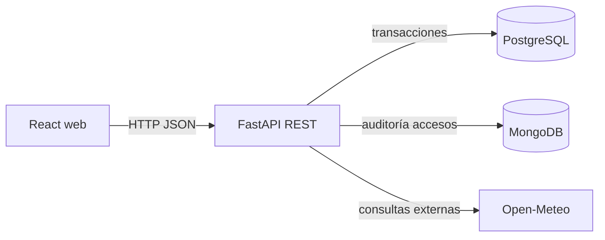

# Guion verificable de exposición — AcreditaQR, Hito 3

> No completar esta guía con capturas inventadas. Marcar cada demostración solo después de haberla realizado en el entorno indicado. Las capturas automáticas de Pages demuestran la interfaz local, no SQL/NoSQL.

## Entorno A: Full Stack real con Docker

1. Clonar repo y preparar `.env`. Ejecutar `docker compose up --build -d`. Comprobar `docker compose ps`.
2. Ejecutar `docker compose exec backend python -m app.seed`.
3. Configurar una cuenta organizadora con `python -m app.configurar_organizador` (ver README para variables requeridas; nunca publicar la clave).
4. Abrir React `http://localhost:5173` y Swagger `http://localhost:8000/docs`.
5. Intentar entrar al panel de organizador sin contraseña; el frontend debe pedir login. Comprobar en Swagger que `GET /api/indicadores` sin token devuelve 401.
6. Iniciar sesión de organizador. Comprobar creación, edición y publicación de un evento; confirmar después con `GET /api/eventos`.
7. Desde una sesión pública, inscribirse a un evento pagado. Mostrar la entrada en estado pendiente y el QR. El pago es **simulado** (no hay dinero real).
8. Emitir comprobante y demostrar que el estado cambia a confirmado. Un intento de leer la entrada sin el código privado debe devolver 403.
9. Acreditar el código desde el panel del organizador. Volver a acreditarlo y verificar el rechazo por duplicado. Comprobar la bitácora MongoDB y el estado de la inscripción en PostgreSQL.
10. Ejecutar `docker compose exec -e RUN_MONGO_INTEGRACION=1 backend python -m pytest tests/ -v` y registrar el resultado real.
11. Mostrar estados de carga, errores, vacío y responsive. Conservar capturas reales y salida de CI.
12. Describir la API Open-Meteo, sus estados posibles y cómo se gestiona una falla.

## Entorno B: GitHub Pages — SOLO demostración estática

- URL prevista: https://crisito27.github.io/Proyecto-Gesti-n-de-eventos-y-acreditaci-n-QR/
- Modo demo claramente visible: usa datos ficticios de prueba guardados en el navegador.
- Recorrido: catálogo → inscripción → QR → pago simulado → acreditación → intento duplicado → dashboard y bitácora.
- No se debe decir que Pages guarda en PostgreSQL o MongoDB.
- El workflow `evidencia-pages.yml` ejecuta Chromium para comprobar el recorrido y adjunta capturas descargables en el propio run.

## Arquitectura y datos para explicar

**PostgreSQL:** usuarios, organizadores, categorías, eventos, inscripciones, pagos, credenciales de acceso. Garantiza integridad con claves y restricciones. El control de aforo usa bloqueo transaccional.

**MongoDB:** colección `registros_acceso` con hechos históricos por intento; no almacena una segunda copia de todas las inscripciones. Los campos de detalle varían por resultado.

**Seguridad:** el organizador inicia sesión, el hash es PBKDF2-SHA256 y el token es temporal con firma HMAC. Las entradas públicas requieren su código para lectura y pago. No exponer claves ni usar el modo demo para datos personales reales.

**Límites:** Pages no aloja un backend; las cuentas de asistentes no verifican correo; la escritura SQL y Mongo no es una transacción distribuida; `create_all` no migra cambios de columnas; los pagos son simulados. No ocultar estas limitaciones.

## Preguntas frecuentes de defensa

**¿Por qué SQL y NoSQL?** El estado relacional necesita transacciones, FKs y unicidad; las trazas de acceso son documentos inmutables cuya forma cambia según el resultado.

**¿Cómo se evita superar aforo?** El backend bloquea la fila del evento (`SELECT FOR UPDATE`) al inscribir y contar cupos; después confirma o rechaza la transacción.

**¿Cómo se evita doble pago?** Pago único por inscripción y comprobantes únicos en SQL; el correlativo se obtiene bajo bloqueo transaccional.

**¿Qué pasa cuando Mongo falla después de confirmar SQL?** Puede haber inconsistencia parcial; se reconoce como limitación y en producción se utilizaría outbox/reintentos.

**¿Por qué una interfaz de Pages puede funcionar sin base de datos?** Es una demo local explícita; el Hito 3 completo se verifica solo con el entorno Full Stack conectado al backend.

## Registro de validación del equipo

Completar con fecha, integrante, dispositivo y evidencia real:

| Prueba | Resultado real | Captura/log | Responsable |
|---|---|---|---|
| Arranque Docker y seed | Pendiente de verificación humana | — | Equipo |
| Login real / sin sesión 401 / rol incorrecto 403 | Pruebas automáticas implementadas; confirmar manualmente | GitHub Actions | Equipo |
| Inscripción → pago → QR → acreditación | Pruebas API automatizadas; confirmar desde React | GitHub Actions | Equipo |
| Registro de MongoDB real | Prueba de integración automatizada | GitHub Actions | Equipo |
| Interfaz responsive | Prueba de navegador programada; ver resultado del workflow | Artefacto de Actions | Equipo |
| Explicación individual de IA | Pendiente | — | Cada integrante |
