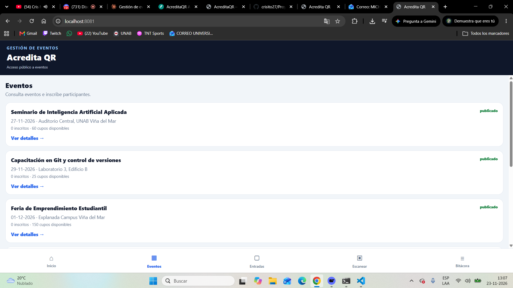
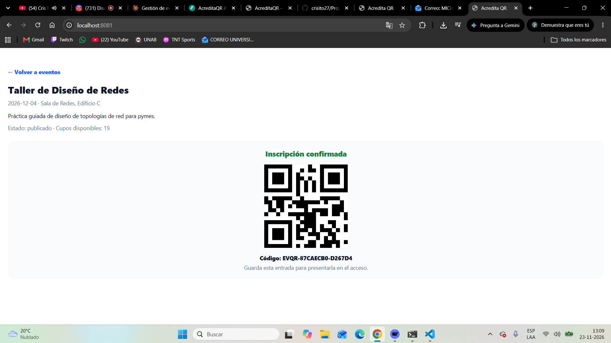
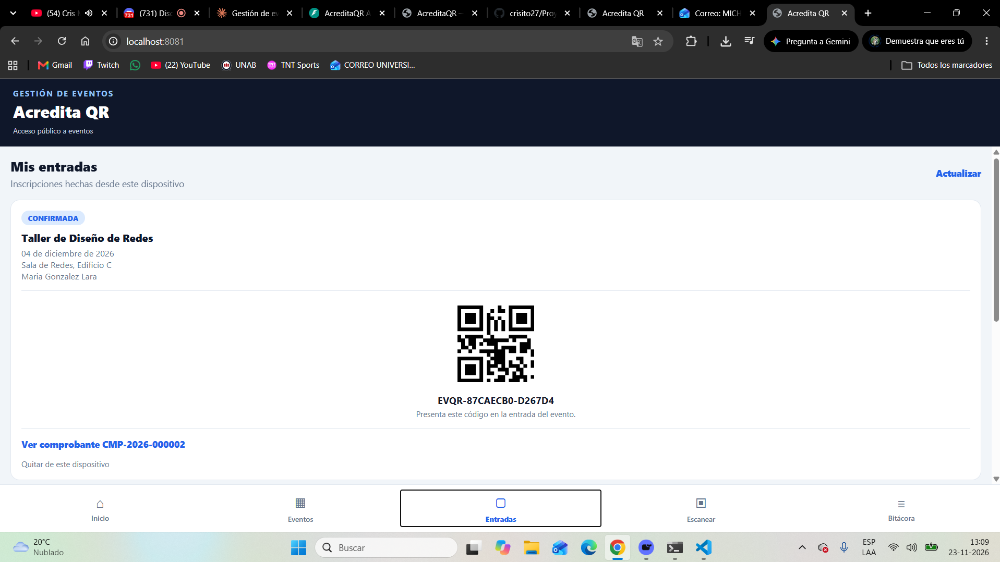
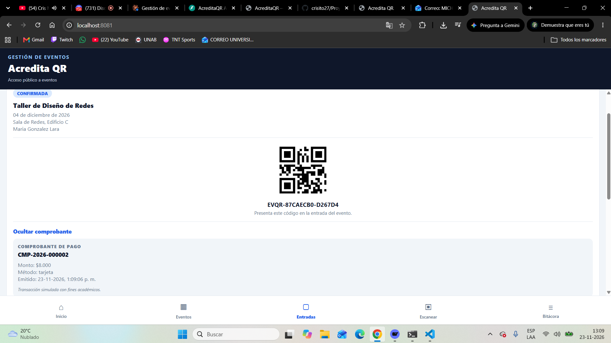
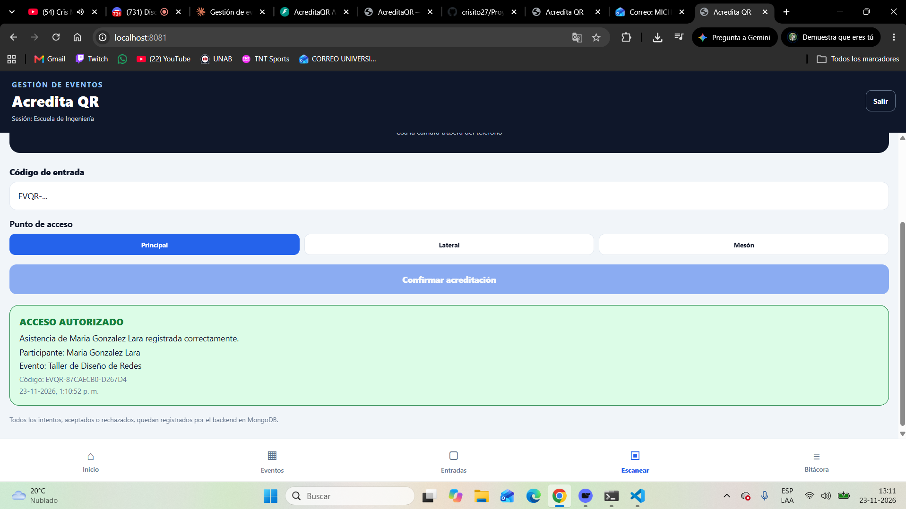
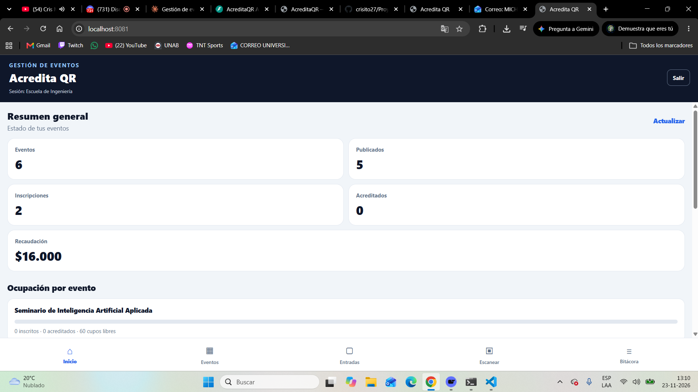
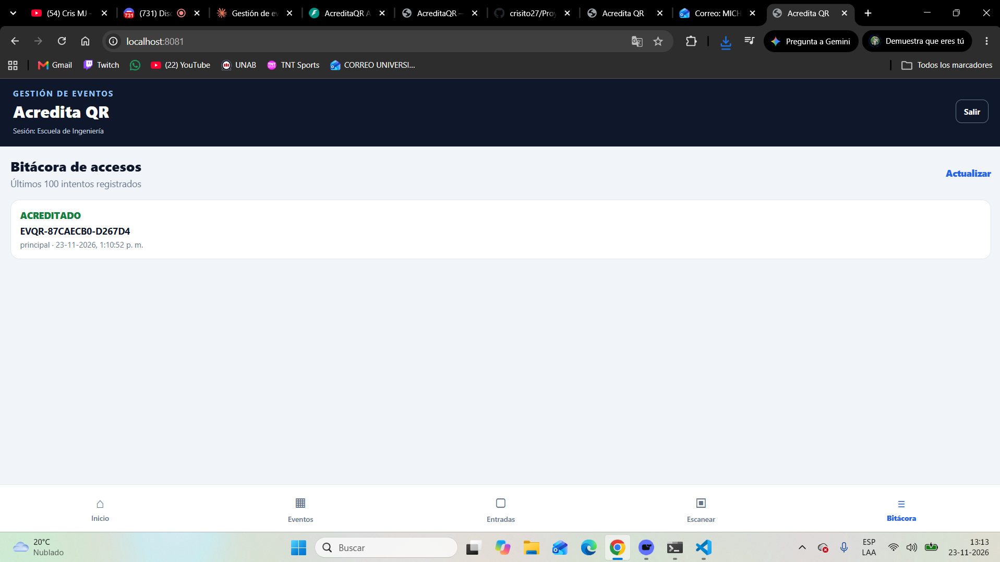

# Hito 4 — Aplicación móvil Acredita QR

Documentación de la aplicación móvil desarrollada con React Native (Expo) que
consume la API FastAPI construida en el Hito 3.

- **Repositorio:** https://github.com/crisito27/Proyecto-Gesti-n-de-eventos-y-acreditaci-n-QR
- **Rama:** `mobile`
- **Carpeta:** `mobile/`

---

## 1. Qué resuelve la aplicación

El sistema Acredita QR gestiona eventos universitarios y controla el acceso
mediante códigos QR. La aplicación móvil cubre los tres flujos de uso que
ocurren fuera del escritorio:

| Flujo | Quién lo usa | Dónde ocurre |
|---|---|---|
| Consultar eventos e inscribirse | Asistente | Antes del evento, desde su teléfono |
| Consultar la entrada y el comprobante | Asistente | Camino al evento, en la puerta |
| Escanear QR y acreditar asistencia | Organizador | En la entrada del recinto |

La aplicación **no tiene lógica de negocio propia ni base de datos local**.
Todas las reglas (cupos, estados, validez de un código, emisión de comprobantes)
viven en el backend. La app es un cliente de esa API.

---

## 2. Dónde encaja la app en el sistema

```
┌──────────────────┐     ┌──────────────────┐
│  App móvil       │     │  App web         │
│  React Native    │     │  React + Vite    │
│  (Expo)          │     │                  │
└────────┬─────────┘     └────────┬─────────┘
         │                        │
         │   HTTP / JSON  +  WebSocket
         │                        │
         └───────────┬────────────┘
                     ▼
         ┌───────────────────────┐
         │  API REST — FastAPI   │
         │  routers → services   │
         └───────┬───────┬───────┘
                 │       │
         ┌───────▼──┐ ┌──▼────────┐
         │PostgreSQL│ │  MongoDB  │
         │ estado   │ │ bitácora  │
         └──────────┘ └───────────┘
```

Las dos aplicaciones cliente consumen exactamente la misma API. Un evento
creado desde la web aparece en la app móvil, y una acreditación hecha desde el
teléfono queda registrada en la bitácora que ve la web.

---

## 3. Pantallas principales y flujos

> **Capturas:** guardar en `docs/capturas-hito4/` con los nombres indicados.

### 3.1 Eventos (pública)



Listado de eventos publicados con fecha, lugar, cupos disponibles e inscritos.
Los cupos **no se guardan** como un número en la tabla: se calculan contando las
inscripciones vigentes, de modo que el dato nunca se contradice con la realidad.

Al tocar *Ver detalles* se abre el formulario de inscripción.

### 3.2 Inscripción y pago



Flujo:

1. El asistente llena nombre, correo y teléfono.
2. La app envía `POST /api/inscripciones/publica`. El backend valida el cupo
   dentro de una transacción con bloqueo (`SELECT FOR UPDATE`) para que dos
   personas no puedan tomar el último cupo a la vez.
3. El backend genera el código de acreditación con `secrets.token_hex` y lo
   devuelve. **El código lo emite el servidor, nunca el teléfono**: es la
   credencial de acceso al evento.
4. La app envía `POST /api/pagos` con el código en la cabecera
   `X-Codigo-Entrada`. Si el evento es gratuito el método es `gratuito`.
5. La app vuelve a consultar la inscripción para confirmar que el pago quedó
   registrado, y recién entonces muestra el QR. No se asume el éxito a partir
   de la respuesta del pago.

### 3.3 Mis entradas (pública)



Permite al asistente recuperar sus entradas y comprobantes después de cerrar la
aplicación.

**Problema de diseño:** el asistente no tiene cuenta en el sistema. Se
identifica únicamente por el código de su entrada. ¿Cómo sabe la app cuáles
inscripciones son suyas?

**Solución adoptada:** el dispositivo guarda **sólo referencias** —el `id` y el
`codigo` de cada inscripción hecha desde ahí— en `expo-secure-store` (o
`localStorage` en la versión web). Cada vez que se abre la pantalla, la app le
pregunta al backend el estado actual de cada inscripción.

**Por qué no se guarda la entrada completa:** el estado cambia fuera del
teléfono. Si el organizador acredita la entrada en la puerta, una copia local
seguiría diciendo "confirmada". Guardando referencias, la pantalla muestra
siempre "Asistencia registrada" en cuanto el organizador escanea el QR.

Es el mismo criterio que usa la aplicación web, que guarda en `localStorage` el
identificador de la última inscripción y no sus datos.

### 3.4 Comprobante de pago



El comprobante se pide bajo demanda a `GET /api/pagos/{id}/comprobante`,
enviando el código de la entrada en la cabecera `X-Codigo-Entrada`. El backend
no entrega el comprobante a quien no posee ese código, aunque conozca el
identificador del pago.

### 3.5 Escáner y acreditación (organizador)



Usa la cámara mediante `expo-camera`. Al leer un código se envía
`POST /api/acreditaciones`, y el backend responde con uno de tres resultados:

| Resultado | Significado |
|---|---|
| `acreditado` | Entrada válida y pagada; asistencia registrada |
| `duplicado` | El código ya había sido acreditado antes |
| `codigo_invalido` | El código no existe o la inscripción no está pagada |

Los tres casos quedan guardados en MongoDB, incluidos los intentos fallidos.
Si se deniega el permiso de cámara, el código puede ingresarse a mano.

### 3.6 Panel e indicadores (organizador)



Requiere iniciar sesión como organizador. Muestra aforo, inscritos y
acreditados por evento.

### 3.7 Bitácora (organizador)



Historial de intentos de acceso leído desde MongoDB, con su resultado y
momento.

---

## 4. Endpoints de la API que consume la app

Todos cuelgan del prefijo `/api`, salvo el WebSocket.

| Método | Ruta | Para qué | Acceso |
|---|---|---|---|
| `POST` | `/api/auth/login` | Iniciar sesión de organizador | Pública |
| `GET` | `/api/auth/yo` | Restaurar la sesión guardada | Token |
| `GET` | `/api/eventos` | Catálogo de eventos | Pública |
| `POST` | `/api/inscripciones/publica` | Inscribir a un asistente sin cuenta | Pública |
| `GET` | `/api/inscripciones/{id}` | Estado de una inscripción propia | `X-Codigo-Entrada` |
| `POST` | `/api/pagos` | Registrar el pago simulado | `X-Codigo-Entrada` |
| `GET` | `/api/pagos/{id}/comprobante` | Comprobante de un pago propio | `X-Codigo-Entrada` |
| `POST` | `/api/acreditaciones` | Acreditar asistencia por código | Organizador |
| `GET` | `/api/registros-acceso` | Bitácora de accesos (MongoDB) | Organizador |
| `GET` | `/api/indicadores` | Aforo, inscritos y acreditados | Organizador |
| `WS` | `/ws` | Aviso de cambios en tiempo real | Pública |

### Los tres modos de acceso

- **Pública** — sin credenciales. El catálogo y la inscripción deben estar
  abiertos porque el asistente no tiene cuenta.
- **`X-Codigo-Entrada`** — prueba de posesión. Quien tiene el código de la
  entrada puede consultarla y pagarla; nadie más. Evita que alguien lea
  inscripciones ajenas probando identificadores correlativos.
- **Organizador** — token JWT obtenido en `/api/auth/login`, enviado como
  `Authorization: Bearer <token>`. El token se guarda con `expo-secure-store`,
  que en Android e iOS usa el almacén cifrado del sistema operativo.

### Sobre el WebSocket

El WebSocket **no transporta datos**: sólo avisa que algo cambió. Al recibir el
aviso, la app vuelve a pedir la información por REST. Así hay una sola fuente de
verdad y el socket no puede quedar desincronizado.

El cliente reintenta la conexión cada 3 segundos si se cae, y envía un `ping`
cada 25 segundos para que proxies o routers no cierren la conexión por
inactividad.

---

## 5. Configuración de la URL del servidor

La app **no tiene ninguna dirección escrita en el código**. La toma de la
variable de entorno `EXPO_PUBLIC_API_URL`, declarada en `mobile/.env`:

```env
EXPO_PUBLIC_API_URL=http://localhost:8000/api
```

Expo expone al código del cliente únicamente las variables con el prefijo
`EXPO_PUBLIC_`. El archivo se lee **al compilar el bundle**, por lo que si se
modifica hay que reiniciar Expo; recargar el navegador no basta.

Si la variable no está definida, la app no intenta conectarse: muestra el
mensaje *"Configura EXPO_PUBLIC_API_URL en mobile/.env"*. Es preferible un error
claro a un fallo de red sin explicación.

### Qué dirección usar según dónde corre la app

| Dónde se ejecuta | Valor |
|---|---|
| Navegador del mismo computador | `http://localhost:8000/api` |
| Teléfono físico con Expo Go | `http://<IP-LAN-del-PC>:8000/api` |
| Emulador Android | `http://10.0.2.2:8000/api` |
| Simulador iOS | `http://localhost:8000/api` |

En un teléfono físico, `localhost` apunta al teléfono mismo, no al computador:
hay que usar la IP de la red local (Expo la muestra al arrancar, en la línea
`Metro: exp://192.168.x.x:8081`). Ambos dispositivos deben estar en la misma
Wi-Fi y el firewall debe permitir el puerto 8000.

### WebSocket

La dirección del WebSocket se deduce de la anterior: se cambia `http` por `ws`
y `/api` por `/ws`. Si el backend está publicado en otra ruta, se define
explícitamente:

```env
EXPO_PUBLIC_WS_URL=ws://192.168.1.100:8000/ws
```

### CORS

El backend sólo acepta peticiones desde los orígenes declarados en la variable
`CORS_ORIGENES` del `.env` de la raíz. El puerto de Expo (8081 por defecto)
debe estar en esa lista:

```env
CORS_ORIGENES=http://localhost:5173,http://localhost:4173,http://localhost:8081
```

Si Expo encuentra el 8081 ocupado se cambia al 8082, y entonces el backend
rechaza sus peticiones. El síntoma es *"No se pudo conectar con Acredita QR"*
mientras el backend está perfectamente levantado.

---

## 6. Cómo levantar el sistema completo

Requisitos: Docker Desktop (con WSL2 en Windows) y Node.js.

```bash
# 1. Backend y bases de datos
cd proyecto-eventos
docker compose up -d --build

# 2. Datos de prueba (sólo la primera vez)
docker compose exec backend python -m app.seed

# 3. Credenciales de organizador (sólo la primera vez)
docker compose exec \
  -e ORGANIZADOR_EMAIL=ingenieria@uandresbello.edu \
  -e ORGANIZADOR_PASSWORD=AcreditaQR2026 \
  backend python -m app.configurar_organizador

# 4. Aplicación móvil
cd mobile
npm install
npm run web      # navegador
# o bien
npx expo start   # teléfono físico con Expo Go
```

Verificación:

- API y documentación interactiva: http://localhost:8000/docs
- Aplicación web: http://localhost:5173
- Aplicación móvil: http://localhost:8081

---

## 7. Estructura del proyecto móvil

```text
mobile/
├── App.js                      navegación por pestañas y sesión
├── app.json                    configuración de Expo y permisos
├── .env                        URL del servidor (no se versiona)
└── src/
    ├── components/
    │   ├── EventCard.js        tarjeta de evento
    │   ├── LoadingView.js      estados de carga y error reutilizables
    │   └── StatCard.js         indicador numérico
    ├── screens/
    │   ├── EventsScreen.js     catálogo e inscripción
    │   ├── MyTicketsScreen.js  entradas propias y comprobantes
    │   ├── ScannerScreen.js    escáner QR y acreditación
    │   ├── DashboardScreen.js  indicadores del organizador
    │   ├── LogsScreen.js       bitácora de accesos
    │   └── LoginScreen.js      inicio de sesión
    ├── services/
    │   ├── api.js              cliente HTTP y manejo de errores
    │   ├── almacenamiento.js   referencias locales a las entradas
    │   └── realtime.js         WebSocket con reconexión
    └── theme/
        └── colors.js           paleta compartida
```

Las pantallas no llaman a `fetch` directamente: todo pasa por `services/api.js`,
que centraliza la URL base, las cabeceras, el token y la traducción de errores
del backend a mensajes legibles. Si cambia la forma de autenticarse, se cambia
en un solo archivo.

---

## 8. Dependencias principales

| Paquete | Para qué |
|---|---|
| `expo` ~58.0 | Plataforma de desarrollo y ejecución |
| `react-native` 0.88 | Componentes nativos |
| `expo-camera` | Lectura de códigos QR |
| `expo-secure-store` | Almacén cifrado del sistema operativo |
| `react-native-qrcode-svg` | Generación del QR de la entrada |
| `react-native-web` | Ejecución en navegador para desarrollo |

---

## 9. Limitaciones conocidas

- **El pago es simulado.** No hay pasarela real. Cada comprobante lo indica.
- **Las entradas guardadas son por dispositivo.** Si el asistente cambia de
  teléfono, no las recupera. Resolverlo requeriría que el asistente tuviera
  cuenta, lo que contradice el diseño de inscripción abierta. Una alternativa
  sería enviarle el enlace por correo.
- **El WebSocket mantiene las conexiones en memoria.** Con varios procesos del
  backend en paralelo, cada uno notificaría sólo a sus propios clientes. Una
  instalación real necesitaría un mecanismo compartido como Redis Pub/Sub.
- **Sin despliegue público.** El backend corre en local con Docker. Publicarlo
  exigiría HTTPS/WSS, un servidor con bases de datos persistentes y gestión de
  secretos.

---

## 10. Uso de inteligencia artificial

Declarado en [`docs/uso-ia.md`](uso-ia.md).
