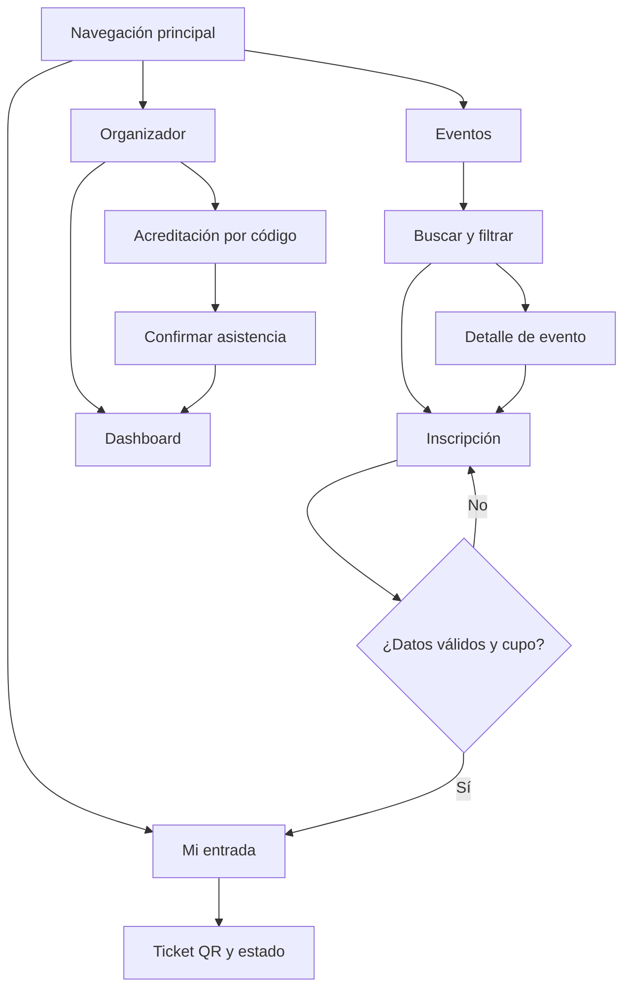

# Diseño de interfaz — AcreditaQR

Este documento consolida el diseño de la solución React del Taller Evaluado 2.
Sirve como respaldo de navegación, jerarquía visual, componentes repetibles,
criterios visuales y flujos principales.

> Importante: el taller solicita evidencia de diseño previo. Este documento
> describe el diseño utilizado por la aplicación, pero el equipo debe adjuntar
> además una evidencia fechada previa o temprana (Figma, dibujo, captura, archivo
> o commit) si dispone de ella.

## 1. Usuarios y necesidades

### Asistente
- Encontrar eventos por nombre, lugar, categoría o disponibilidad.
- Conocer cupos antes de intentar inscribirse.
- Completar una inscripción con datos válidos.
- Obtener una entrada digital con un código único y QR.
- Consultar el estado de su entrada.

### Organizador
- Buscar una entrada por código.
- Registrar una asistencia.
- Evitar acreditar dos veces la misma entrada.
- Consultar aforo, inscritos y asistentes por evento.

## 2. Mapa de navegación

```text
Eventos
 ├─ Buscar / filtrar
 ├─ Seleccionar evento
 │   └─ Modal de inscripción
 │       ├─ Pronóstico (eventos exteriores)
 │       ├─ Formulario
 │       └─ Confirmar
 │           └─ Mi entrada
 │               └─ Ticket + QR
 └─ Navegación superior
     ├─ Eventos
     ├─ Mi entrada
     └─ Organizador
         ├─ Acreditación
         └─ Dashboard
```

## 3. Flujo principal

```text
Inicio
→ Buscar/filtrar evento
→ Revisar cupos
→ Inscribirse
→ Validar formulario
→ Generar inscripción
→ Mostrar entrada QR
→ Organizador busca código
→ Confirmar asistencia
→ Dashboard se actualiza
```

## 4. Wireframes de referencia

### Vista Eventos

```text
┌──────────────────────────────────────────────────────────────┐
│ AcreditaQR          Eventos | Mi entrada | Organizador       │
├──────────────────────────────────────────────────────────────┤
│ Encuentra tu próximo evento                                 │
│ [ Buscar... ] [ Categoría ▼ ] [ Cupos ▼ ] [ X ]            │
│                                                              │
│ ┌───────────────────────┐  ┌───────────────────────┐         │
│ │ Categoría             │  │ Categoría             │         │
│ │ Nombre del evento     │  │ Nombre del evento     │         │
│ │ Fecha / lugar         │  │ Fecha / lugar         │         │
│ │ descripción           │  │ descripción           │         │
│ │                 18    │  │                  0    │         │
│ │             [Inscribir]│ │             [Agotado] │         │
│ └───────────────────────┘  └───────────────────────┘         │
└──────────────────────────────────────────────────────────────┘
```

### Modal de inscripción

```text
┌───────────────────────────────────────┐
│ Inscripción                     [ X ] │
│ Evento — fecha                        │
├───────────────────────────────────────┤
│ Pronóstico del tiempo (si exterior)   │
│                                       │
│ Nombre completo [________________]    │
│ Correo          [________________]    │
│ Teléfono        [________________]    │
│                                       │
│              [Cancelar] [Confirmar]   │
└───────────────────────────────────────┘
```

### Mi entrada

```text
┌───────────────────────────────────────────────────┐
│ Mi entrada                                        │
│ ┌───────────────────────────┬───────────────────┐ │
│ │ ENTRADA DIGITAL           │      [ QR ]       │ │
│ │ Evento                    │   EVQR-XXXX       │ │
│ │ Persona / fecha / lugar   │                   │ │
│ │ [Inscrito / Asistió]      │                   │ │
│ └───────────────────────────┴───────────────────┘ │
└───────────────────────────────────────────────────┘
```

### Panel del organizador

```text
┌───────────────────────────────────────────────────┐
│ Panel del organizador                             │
│ [Acreditación] [Dashboard]                        │
│                                                   │
│ Código [ EVQR-____________ ] [Buscar]             │
│ Resultado / confirmación                          │
│                                                   │
│ Dashboard: tarjetas de aforo por evento           │
└───────────────────────────────────────────────────┘
```

## 5. Jerarquía visual

1. Título de la vista.
2. Acción principal o filtros.
3. Contenido principal en tarjetas/paneles.
4. Estados secundarios: cupos, alertas, clima y confirmaciones.
5. Navegación y pie de página como elementos persistentes.

## 6. Componentes repetibles

- `Navbar`: navegación entre vistas.
- `FiltrosEventos`: búsqueda y filtros controlados.
- `ListaEventos`: renderiza colecciones con keys.
- `EventoCard`: representación reutilizable de cada evento.
- `ModalInscripcion`: captura y valida datos.
- `ClimaEvento`: estado de carga/error/datos de la API.
- `Ticket`: entrada digital con QR.
- `CheckIn`: acreditación de asistentes.
- `Dashboard`: indicadores derivados del estado.

## 7. Identidad visual

- Azul oscuro: identidad principal y acciones importantes.
- Ámbar: acento visual y llamadas a la acción.
- Verde: estados exitosos.
- Rojo: aforo completo o errores.
- Superficies claras y bordes suaves para priorizar legibilidad.
- Motivo de “ticket perforado” en tarjetas y entrada digital.
- Bootstrap para grilla/utilidades y CSS propio para identidad.

## 8. Responsive

- En escritorio, las tarjetas se distribuyen en dos columnas.
- En pantallas pequeñas, cada tarjeta pasa a una columna.
- El “stub” lateral del ticket se convierte en una franja horizontal.
- Formularios y filtros usan columnas Bootstrap que se apilan en móvil.
- Los controles mantienen foco visible para navegación por teclado.

## 9. Decisiones que deben poder defenderse

- No se usa React Router porque la aplicación es pequeña y sus tres vistas
  pueden representarse con estado local sin introducir una dependencia extra.
- El estado compartido vive en `App.jsx`; el estado que sólo afecta a una vista
  se mantiene en el componente correspondiente.
- Los datos iniciales están en JSON y los cambios del usuario se conservan en
  `localStorage`, ya que el enunciado no exige backend.
- La API meteorológica aporta valor a eventos al aire libre antes de confirmar
  una inscripción.

## Actualización del diseño de detalle

Esta sección se documentó durante el cierre técnico; no constituye evidencia
histórica de diseño previo. Desde cada tarjeta se abre un diálogo con nombre,
descripción completa, fecha, lugar, organizador, categoría, ambiente y cupos.
Sus acciones son Volver e Inscribirme (deshabilitada si está agotado). Escape
cierra el diálogo y el elemento nativo `dialog` mantiene el foco modal.

Flujo actualizado: Eventos → Ver detalle → Inscribirme → Validación → Entrada
QR → Acreditación → Dashboard. La inscripción directa también se conserva.

Tipografías: Space Grotesk para títulos y marca; Public Sans para texto y
controles, con sans-serif como respaldo. Los títulos distinguen las secciones
y el texto de cuerpo prioriza legibilidad en formularios y tarjetas.

## Mapa de navegación actualizado



El detalle permanece disponible cuando no hay cupos. En ese caso, su botón de
inscripción está deshabilitado. La inscripción directa desde la tarjeta se mantiene.

## Distribución del detalle de evento

El diálogo contiene estos elementos de arriba hacia abajo:

| Zona | Contenido | Comportamiento |
|---|---|---|
| Cabecera | Nombre del evento y cerrar | Cierre por botón o Escape |
| Descripción | Texto completo | Sin recorte de la tarjeta |
| Información | Fecha, lugar, organizador y categoría | Lectura |
| Ambiente | Interior o al aire libre | Lectura |
| Cupos | Disponibles y capacidad total | Cálculo derivado |
| Acciones | Volver e Inscribirme | Agotado deshabilita inscripción |

Los wireframes gráficos editables del listado, detalle, inscripción, entrada y
organizador acompañan la presentación de la entrega. Son documentación actual,
no evidencia histórica anterior a la implementación.
